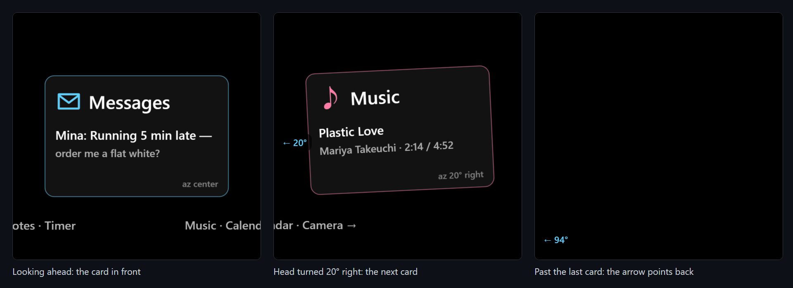
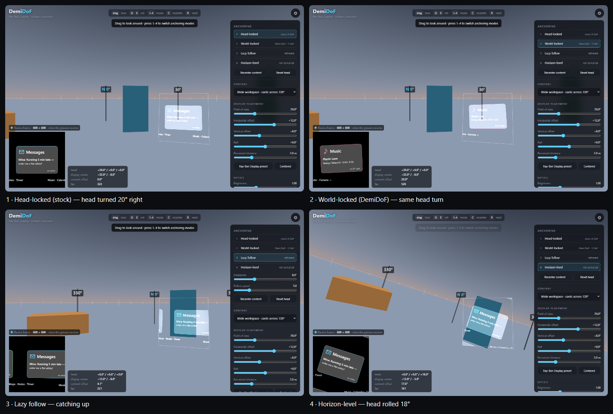

<div align="center">

# DemiDoF

**World-anchored content on the head-locked Meta Ray-Ban Display.**
Turn your head and the 20° display sweeps across a workspace that stays put in the room.


[Quick start](#quick-start) · [How it works](#how-it-works) · [Hardware notes](#hardware-notes) · [Development](#development) · [Roadmap](#roadmap)



</div>

## Why

The Ray-Ban Display shows a 600 × 600 image, about 20° wide, fixed in the lower right of the right
lens. Everything an app draws is glued to the head: zero degrees of freedom.

DemiDoF gives that window *half* a degree of freedom in software. The content is anchored in the
world, and the display becomes a peephole you steer with your head. A row of cards 120° wide fits in
a 20° screen, because you look at one card at a time, the way you would look around a desk.

It is a proof of concept, and it runs on the real glasses as a Web App: plain HTML and JavaScript,
no native SDK.

## Features

| | On the glasses (`glasses.html`) | Desktop simulator (`index.html`) |
| --- | --- | --- |
| **What you see** | The 600 × 600 display itself, drawn on black (black is transparent on the waveguide) | A first-person room with the virtual display overlaid at its real size and place |
| **Anchoring** | World-locked | Head-locked, world-locked, lazy follow, horizon-level |
| **Head input** | The glasses' gyroscope and accelerometer, filtered and predicted | Mouse, keys, phone gyroscope, scripted demo, Quest WebXR (right eye only) |
| **Content** | Cards across 120°, HUD demo, angular grid | Same, plus FOV / offset / roll / brightness sliders and PNG export of the device frame |
| **Diagnostics** | On-screen readout, remote log to the dev server | Live numbers for head, display centre and content offset |



## Quick start

### On the Ray-Ban Display

You need glasses firmware **v125+**, the Meta AI app **v272+**, and the page on a **public HTTPS
URL**. Plain HTTP and self-signed certificates are rejected.

1. Serve the repo and open a tunnel to it:

   ```sh
   python serve.py                                  # http://localhost:8000
   cloudflared tunnel --url http://localhost:8000   # prints https://<random>.trycloudflare.com
   ```

   GitHub Pages also works, because the repo is static. The quick-tunnel URL changes every time the
   tunnel restarts, for example after the PC sleeps.
2. In the Meta AI app, open **Settings → App Info** and tap **App version** five times. Enable
   **Developer Mode** (once).
3. Go to **App Settings → Apps → Web Apps → Connect Web App**, enter `https://<host>/glasses.html`
   and save.
4. On the glasses, open DemiDoF from the end of the app grid. Select **Start** and allow the motion
   sensors.
5. Look straight ahead, hold still for a second, and tap. Turn your head: the cards stay where they
   are.

### On a desktop

```sh
python serve.py            # http://localhost:8000          simulator
                           # http://localhost:8000/glasses.html   the glasses page, drag to look
python serve.py --https    # https://<lan-ip>:8443  for phone gyro, camera and Quest WebXR
```

`--https` creates a self-signed certificate in `.cert/` with the `openssl` that ships with Git for
Windows. Meta's **Ray-Ban Display Simulator** Chrome extension (id
`jpjlmmodokemlepklkdbimceggpbjcll`) frames `glasses.html` at 600 × 600 and sends the glasses' key
events, but it does not simulate the IMU.

## Controls

**Glasses**

| Input | Action |
| --- | --- |
| Tap (Select) | Recenter: the way you look becomes forward, and the content moves into the display |
| Swipe ← → | Content: cards → HUD → grid |
| Swipe ↑ ↓ | Readout on / off: sensor source, raw values, gyro bias, filter state, fps |
| Middle-finger pinch | Meta's Web App menu: Restart, Resume, Permissions |

**Simulator**

| Input | Action |
| --- | --- |
| Drag / arrows | Look around |
| `Q` `E` | Roll the head |
| `1` – `4` | Anchoring mode |
| `C` | Recenter content |
| `R` | Reset the head (with gyro: current heading becomes forward) |
| `H` | Hide / show the panel |

## How it works

### Rendering

```
head quaternion ──×── display placement ──► display camera (20° FOV, 1:1)
                                               │ renders the content scene
                                               ▼
            content anchor ◄── mode ──   600 × 600 frame ──► glasses: straight to the canvas
                                                          ──► simulator: overlay in the room + preview
```

Content widgets sit on a sphere around the wearer, placed by azimuth, elevation and angular size.
World-locked means the anchor stays fixed and only the camera turns. Recenter moves the anchor to
where the camera points.

| Mode | Rule for the content anchor `A` and the display camera `D` |
| --- | --- |
| Head-locked | `A = D` every frame (the stock behaviour) |
| World-locked | `A` fixed; recenter sets `A = D` |
| Lazy follow | When `angle(A, D) > deadzone`, slerp `A → D` at `speed`; stop below 0.15° |
| Horizon-level | `A` = yaw and pitch of `D`, roll 0 |

### Head tracking on the glasses

`src/glasses-head.js` is a gyroscope + gravity complementary filter, in the spirit of Mahony's,
tuned for a display.

1. **Gyro integration.** `rotationRate` arrives at about 60 Hz. Its fields are mapped to the device
   axes in the order the glasses actually use (see [Hardware notes](#hardware-notes)). The gyro bias
   is learned whenever the head is still and subtracted.
2. **Tilt correction.** The estimate is pulled towards measured gravity with a 1.5 s time constant,
   but only while the acceleration is within 8 % of g. A quick head movement does not tip the
   horizon.
3. **No compass.** Heading comes from the gyroscope alone. A tap removes the slow yaw drift.
4. **Prediction.** The pose is pushed forward by angular velocity × 30 ms, the sensor-to-display
   latency.
5. **Adaptive smoothing.** A One Euro–style low-pass uses 120 ms when the head is still and 12 ms
   when it moves. The content is still at rest and does not lag in motion.

All time constants are in `DEFAULT_TUNE`.

## Hardware notes

These were measured on a Ray-Ban Display (WebView, Chrome 151, Android 14) from the remote log. They
are not in Meta's documentation.

| Topic | What the glasses do | What DemiDoF does about it |
| --- | --- | --- |
| Device frame | Upright glasses report gravity along +Y; the gaze is −Z | Uses the W3C device frame as-is |
| Gyro channel order | `rotationRate.alpha` = about X (nod), `beta` = Y (turn), `gamma` = Z (tilt). The W3C spec says alpha = Z, beta = X, gamma = Y | Maps by the measured order; `?gyro=spec` switches back |
| Compass heading | `deviceorientation` heading turns the opposite way to the gyro and jumps near β = 90° | Ignored while the gyroscope works; fusing it made the content spin |
| Gyro bias | 1–2 °/s at rest | Learned while still (< 4 °/s for 0.6 s) |
| Sensor rate | `devicemotion` and `deviceorientation` both at about 60 Hz | Fuses every motion sample |
| Rendering | WebGL at about 60 fps | Renders the content straight to the canvas |
| Tap | Arrives as `Enter` keydown / keyup **and** a click on the canvas | Debounced into one action |
| Swipes | Arrive as arrow keys | Content and readout |
| Sensor permission | Remembered per domain; a refusal sticks | Re-enable it in the Web App menu → Permissions |

The page POSTs a log of raw sensor values, pose and input events to `/log` on the server it came
from. `serve.py` appends it to `logs/<date>.jsonl`. Add `?log=0` to turn it off.

## Development

```sh
npm install && npx playwright install chromium
npm test                          # headless check of the simulator and the glasses page
node tools/make-icons.mjs         # assets/icon-96.png and icon-180.png from favicon.svg
node tools/make-readme-shots.mjs  # docs/glasses.png (needs python serve.py running)
```

`npm test` renders every simulator mode, then drives `glasses.html` with synthetic sensor events. It
checks gyro bias learning, the turn and nod directions in the glasses' channel order, that compass
events do not move the gyro pose, recenter, the edge arrow and the drag fallback. Screenshots go to
`test-output/`.

### Project structure

| Path | Role |
| --- | --- |
| `glasses.html`, `src/glasses.js` | The on-glasses Web App: input, readout, frame loop |
| `src/glasses-head.js` | Head tracker: gyro + gravity fusion, prediction, adaptive filter |
| `src/glasses-log.js` | Remote log, batched POST to `/log` |
| `index.html`, `src/main.js` | Simulator frame loop |
| `src/display.js` | Display camera, 600 × 600 render target, anchoring modes, additive overlay |
| `src/content.js` | Widgets on a sphere, drawn with Canvas 2D |
| `src/head.js` | Simulator head input: pointer, keys, phone gyro, demo motion |
| `src/world.js`, `src/xr.js` | Simulator room; WebXR session with the overlay in the right eye only |
| `serve.py` | Dev server with HTTPS option and the `/log` endpoint |
| `vendor/three.module.js` | three.js r170, vendored; no build step |

### Assumptions

* 600 × 600 px and about 20° FOV are the widely reported specs. The placement in the simulator
  (+12° right, −8° down) and the focal distance are estimates.
* Bright waveguide pixels read as slightly opaque, so the simulator's overlay has an `Occlusion`
  slider. Set it to 0 for pure addition.

## Roadmap

- [x] World-locked content on the real glasses with stable head tracking
- [ ] Stability: drift-free heading without a compass, auto-recenter when the head rests
- [ ] Battery: render only when the pose changes, lower the frame rate at rest
- [ ] More content and interactions for the world-anchored workspace
- [ ] Record head-motion traces and replay them to compare anchoring modes

## Acknowledgments

* [luke-hurd/rbm-display-head-gestures-js](https://github.com/luke-hurd/rbm-display-head-gestures-js)
  confirmed the gaze axis of Meta Display Glasses.
* [three.js](https://threejs.org/) for rendering.

## License

No license has been chosen yet. All rights reserved until one is added. This is not an official
Meta product.
